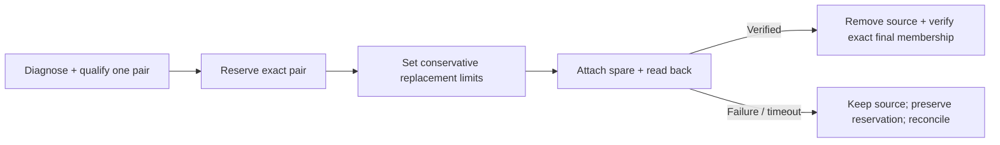

# John: review the pools before the first swap

**Read-only stock audit completed. No PlusVibe settings, memberships or sending changed.**
The proposed draft swap was evaluated against real mailbox evidence and is
**blocked** until pool separation, warmed spares and infrastructure mapping are resolved.

## What the stock check found

Scope: the 910-mailbox campaign cohort plus the existing pre-warmed-stock tag.
All pages of those two inventory filters were read: **4,660 unique mailboxes**.
This is a scoped inventory audit, not the entire shared workspace.
Warmup window: **11–17 November 2026**. Sending window: **15–17 November 2026**.

| Observation | Result | Meaning |
| --- | ---: | --- |
| Deliverable v5 draft | 910 assigned; no leads or sends | Draft, not a launched campaign |
| Catch-all v5 draft | 910 assigned; no leads or sends | Draft, not a launched campaign |
| Shared mailboxes between those drafts | **910 / 910** | The lanes are not isolated |
| Current cohort meeting the mailbox warmup rule | 556 | Warmup evidence passes; not full launch clearance |
| Current cohort below 90% warmup inbox rate | **50 on one domain** | Investigate a shared failure; do not assume 50 unrelated mailbox faults |
| Current cohort below the 50-result warmup minimum | **304 across six domains** | Insufficient evidence per mailbox, even if the domain average looks good |
| Failed representative authentication checks | **Three domains / 154 mailboxes** | Provider SPF/DKIM/DMARC checks need investigation; MX passes |
| Current cohort with passing warmup and a passing domain authentication sample | **402 across eight domains** | Provisional Catch-all candidates; individual and infrastructure checks remain |
| Unassigned mailboxes in scoped stock | **1,650 across 11 domains** | Inventory exists; availability is not readiness |
| Unassigned stock reporting warmup INACTIVE | **1,650 / 1,650** | None qualify as active warmed standbys from the inspected PlusVibe evidence |
| Unassigned stock sampled for seven-day warmup | **200; none reach 50 classified results** | Sample is explicit; no extrapolated per-mailbox health for the other 1,450 |
| Sender-bounce candidates in current cohort | **0** | Four account-level sends, no sender/recipient bounces in this window; this does not establish healthy campaign placement |

DNS checks covered 22 domain representatives, followed by checks targeting the
exact proposed source and sample spare. They were not 4,660 individual checks.
The proposed source has **46 inbox / 70 classified warmup results = 65.71%**,
zero sending in the three-day window and passing authentication checks. Its
49 domain peers also fall below the warmup threshold. That pattern warrants
shared-domain/tenant investigation; it does not prove the cause.

## Proposed pool mapping for review

| Pool | Proposal | Review needed |
| --- | --- | --- |
| Primary | Use a separate, verified clean-history domain group | All 18 domains in the current cohort have Catch-all assignment exposure. Under our agreed rule, splitting that cohort cannot create clean Primary stock. Identify clean stock and qualify it. |
| Catch-all | Start review with the 402 warmup-passing / sample-DNS-passing candidates | Remove cross-lane draft assignments before launch. Verify individual checks, provider capacity and infrastructure. This is a proposed roster, not an applied assignment. |
| Standby | Designate separate reserves for each lane from already purchased stock | Establish active warmup, sufficient fresh results, known warming age, no commitments and a target lane. Primary reserves require clean domain history. The pre-warmed tag alone is not proof. |
| Needs review | Hold the 50 low-warmup, 154 authentication-review and 304 insufficient-sample current senders | Investigate and recheck; no automatic warmup changes, purchases or rotation. |

An external warmup system may hold additional evidence, but it was not connected
in this audit. We have not read John's Turso fleet database. PlusVibe does not
expose verified tenant/infrastructure group IDs in the inspected account payloads.
Supplier confirmation is required; a different domain does not prove a different tenant.

## The actual swap mechanism to review

The API changes are individual mailbox operations. Diagnose the failure scope
first; a tenant-wide issue cannot use another domain on the same affected tenant.
Unknown scope or unknown infrastructure stops the proposed pair.



1. **First test: draft only, no recipient delivery.** Capture exact membership,
   limits and tags; confirm the replacement's provider, target lane, health,
   warming age, availability and infrastructure. Do not fake a health result or
   launch an unhealthy sender to create a trigger.
2. Reserve one exact source/standby pair with one executor. Record it before any
   write and reuse that pair on resume. Do not allocate a second spare after a timeout.
3. `update_email_account` on the spare: use the lowest positive source/spare
   configured/available cap, the slower sending interval and
   `force_exit_recovery: 0`. Read it back with `list_email_accounts`. Preserve
   warmup, rest settings, tags and every other mailbox.
4. `add_campaign_email_account`, then `get_campaign_email_accounts`. Verify the
   exact original set plus the spare, with the source still present. A failed
   read-back must not advance to removal.
5. `remove_campaign_email_account`, then read back the exact original set minus
   source plus spare. Confirm healthy peers and excluded campaigns are unchanged.
   Tag-attached or ambiguous memberships stop this direct-membership procedure.
6. Record success only after provider read-back. Keep drafts unlaunched on any
   failure. A real active-campaign path additionally needs a verified cold-sending
   hold and interruption-safe execution; draft membership tests do not prove it.

The new [pair planner](../scripts/swap-plan.mjs) produces the exact native-MCP
requests and expected membership sets after these gates pass. It is **read-only**:
`executable: false`; it never calls the provider. The real source/sample-spare
input returns **blocked, six findings, zero operations**. No live swap was claimed.
The existing skill's operational loop permits active campaigns only; draft
preflight writes need a separately scoped procedure/authorization after this review.

<details>
<summary>Reproduce a private pair proposal</summary>

Use the agent's already authenticated PlusVibe MCP to refresh the exact workspace,
mailbox records and membership lists. Read the planner input contract in the
[synthetic tests](../scripts/swap-plan.test.mjs). Include confirmed failure scope,
verified infrastructure group IDs, exact mailbox DNS evidence and clean-history
facts. Never infer these from the warmup percentage or an empty membership list.

```sh
node scripts/swap-plan.mjs <private-pair-input.json> <private-pair-plan.json>
node --test scripts/swap-*.test.mjs
```

Exact mailbox addresses, IDs, inventory and source receipts stay in ignored local
state; they are not in this public review file. This committed summary is the
aggregate review requested for John. It does not publish a roster or credentials.

</details>

## John: what to do next

1. Review the proposed groups in PlusVibe; **do not launch both drafts with the same sender set**.
2. Identify clean Primary domains and the intended warmup source for unused stock.
   Supply/confirm the tenant groups for the affected domain and candidate reserves.
3. Confirm one Catch-all source and one fully qualified spare for a controlled
   draft test, plus the exact campaign scope. The source must also be excluded
   from any other campaign you intend to launch.
4. We then wire/apply that scoped draft procedure and prove success plus restart
   handling. Afterward implement/verify live monitoring and sending holds. The
   present code is not an unattended live runner.
