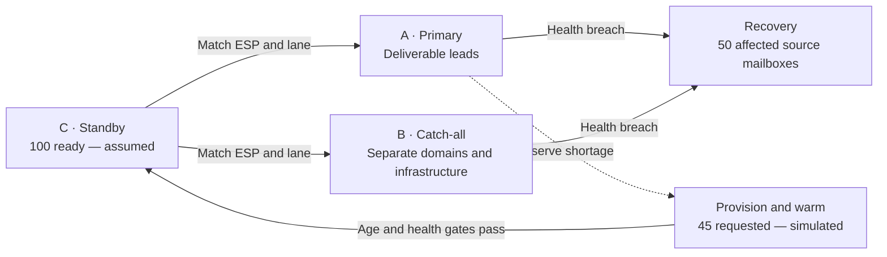

# Simulating one domain replacement

**17 November 2026, 9:36 AM ICT** · example-decline.com

**Synthetic fixture → executed local simulation → expected outcome. No live changes.**

## 1. Start with the incident

| Observed input | Value |
| --- | --- |
| Source | example-decline.com · 50 microsoft mailboxes |
| Actual sending in the inspected window | 138 workspace-level account sends; 0 sender / 0 recipient bounces |
| Authentication check | SPF pass; DKIM pass; DMARC pass; MX pass |
| Weighted seven-day warmup inbox rate | 76.86% · policy minimum 90.00% |
| Target membership copy | Example next primary campaign · DRAFT · 850 assigned mailboxes |

Sending window: 2026-11-14–2026-11-16; warmup: 2026-11-10–2026-11-16. Dates UTC. Sends are not attributed to a campaign from membership alone.

| Date UTC | Daily warmup inbox | Meaning |
| --- | --- | --- |
| 2026-11-04 | 100.00% | Baseline observation |
| 2026-11-10 | 80.00% | Daily evidence |
| 2026-11-12 | 73.00% | Seven-day rule first breaches at 89.57% |
| 2026-11-16 | 76.00% | Daily evidence |

**Model decision:** hold this domain out of the next launch under the warmup rule. DNS passes and zero bounces do not override that rule. The draft remains a draft.

## 2. Define only the pools this scenario needs



A and B are separate campaign lanes. C supplies qualified replacements. Recovery holds affected senders. These roles are the proposed model, not deployed pool tags.

**Simulation assumptions:** 100 ready standbys; same ESP; compatible lane; at least 15 days warmed; passing health; no campaign commitments; independent of the failing infrastructure. The model assumes the source is fully replaced in the one target campaign copy. It does not change other memberships.

## 3. Execute the local membership model

```mermaid
sequenceDiagram
  participant M as Local simulation
  participant C as Standby pool
  participant P as Campaign membership copy
  participant W as Replenishment model
  Note over M,W: All operations below are simulated
  M->>C: Reserve 50 compatible mailboxes
  C-->>M: 100 ready becomes 50 ready plus 50 reserved
  M->>P: Attach replacements (850 becomes 900)
  M->>P: Verify every replacement
  alt All replacements verified
    M->>P: Remove 50 source mailboxes
    P-->>M: 850 assigned - source in recovery
    M->>W: Request 45 mailboxes to restore reserve
  else Any verification fails
    Note over M,P: Keep source attached; record partial attachments
  end
```

| Local step | Assigned to target | Source still assigned | Standby ready | Reserved | Recovery | Warming |
| --- | --- | --- | --- | --- | --- | --- |
| Start | 850 | 50 | 100 | 0 | 0 | 0 |
| Detect health breach | 850 | 50 | 100 | 0 | 0 | 0 |
| Reserve and attach replacements | 900 | 50 | 50 | 50 | 0 | 0 |
| Verify all replacement attachments | 900 | 50 | 50 | 50 | 0 | 0 |
| Remove source; verify final membership | 850 | 0 | 50 | 0 | 50 | 0 |
| Emit refill requirement | 850 | 0 | 50 | 0 | 50 | 0 |
| Assume external provisioning completes | 850 | 0 | 50 | 0 | 50 | 45 |
| Assume warming age and health gates pass | 850 | 0 | 95 | 0 | 50 | 0 |

The temporary 900 assignment count is not extra sending capacity. In the model, all replacements are verified before the source is removed. Source settings expose 100 sends/day; equivalent replacement settings are an assumption, not a delivery forecast.

## 4. Check the failure path

A second run deliberately attaches only 25 of 50 replacements, then fails verification. The model keeps all 50 source mailboxes attached, records 50 reservations, and reports **no completed swap**. Partial attachments remain visible for reconciliation; they are not silently retried with different backups.

## 5. Forecast replenishment

| Calculation | Result |
| --- | --- |
| Reserve policy | ceil(950 unique inspected campaign mailboxes × 10%) = 95 |
| After replacing the source | 100 − 50 = 50 ready standbys |
| Refill request | max(0, 95 − 50) = **45 mailboxes** |
| Conditional return | If external provisioning supplies 45 and all pass age/health gates, ready inventory becomes 95 |

No order is placed. Warming takes at least 15 days after warmup starts; provisioning time is additional. The recovery group is not automatically returned to sending.

## 6. Questions for the joint engineering session

- Trigger: seven-day overall warmup below 90.00%, faster daily deterioration, or recipient-provider-specific results?
- Eligibility: how should ESP, campaign lane and shared tenant/IP constrain replacement matching?
- Handoff: can the backup workflow accept a provider/lane/quantity request and return order, warming and ready states?

> Scope: this is a local count-based simulation backed by the stated observations. Standby stock, replacement qualification and future procurement/health outcomes are assumed. It does not prove production execution, historical pool isolation, causality or improved inbox placement.
