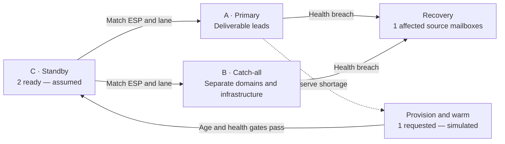

# Simulating one mailbox replacement

**17 November 2026, 9:36 AM ICT** · example-primary.com

**Synthetic fixture → executed local simulation → expected outcome. No live changes.**

## 1. Start with the incident

| Observed input | Value |
| --- | --- |
| Selected mailbox (private) | sender@example-primary.com · mailbox-example-source |
| Source domain | example-primary.com · 1 microsoft mailboxes |
| Actual sending in the inspected window | 100 workspace-level account sends; 0 sender / 0 recipient bounces |
| Authentication check | SPF pass; DKIM pass; DMARC pass; MX pass |
| Weighted seven-day warmup inbox rate | 76.92% · policy minimum 90.00% |
| Target membership copy | Example next primary campaign · DRAFT · 800 assigned mailboxes |

Sending window: 2026-11-14–2026-11-16; warmup: 2026-11-10–2026-11-16. Dates UTC. Sends are not attributed to a campaign from membership alone.

No individual mailbox daily timeline was captured; domain charts remain context only.

**Model decision:** replace only the selected mailbox based on its own fresh evidence. Its domain peers are not automatically selected. The draft remains a draft.

## 2. Define only the pools this scenario needs



A and B are separate campaign lanes. C supplies qualified replacements. Recovery holds affected senders. These roles are the proposed model, not deployed pool tags.

**Simulation assumptions:** 2 ready standbys; same ESP; compatible lane; at least 15 days warmed; passing health; no campaign commitments; independent of the failing infrastructure. The model assumes the source is fully replaced in the one target campaign copy. It does not change other memberships.

## 3. Execute the local membership model

```mermaid
sequenceDiagram
  participant M as Local simulation
  participant C as Standby pool
  participant P as Campaign membership copy
  participant W as Replenishment model
  Note over M,W: All operations below are simulated; one mailbox pair
  M->>C: Reserve 1 compatible mailboxes
  C-->>M: 2 ready becomes 1 ready plus 1 reserved
  M->>P: Attach replacements (800 becomes 801)
  M->>P: Verify every replacement
  alt All replacements verified
    M->>P: Remove 1 source mailboxes
    P-->>M: 800 assigned - source in recovery
    M->>W: Request 1 mailboxes to restore reserve
  else Any verification fails
    Note over M,P: Keep source attached and record partial attachments
  end
```

| Local step | Assigned to target | Source still assigned | Standby ready | Reserved | Recovery | Warming |
| --- | --- | --- | --- | --- | --- | --- |
| Start | 800 | 1 | 2 | 0 | 0 | 0 |
| Detect health breach | 800 | 1 | 2 | 0 | 0 | 0 |
| Reserve and attach replacements | 801 | 1 | 1 | 1 | 0 | 0 |
| Verify all replacement attachments | 801 | 1 | 1 | 1 | 0 | 0 |
| Remove source; verify final membership | 800 | 0 | 1 | 0 | 1 | 0 |
| Emit refill requirement | 800 | 0 | 1 | 0 | 1 | 0 |
| Assume external provisioning completes | 800 | 0 | 1 | 0 | 1 | 1 |
| Assume warming age and health gates pass | 800 | 0 | 2 | 0 | 1 | 0 |

The temporary 801 assignment count is not extra sending capacity. In the model, all replacements are verified before the source is removed. Source settings expose 20 sends/day; equivalent replacement settings are an assumption, not a delivery forecast.

## 4. Check the failure path

A second run attaches 1 replacement in the model, then deliberately fails read-back verification. The model keeps all 1 source mailboxes attached, records 1 reservations, and reports **no completed swap**. Partial attachments remain visible for reconciliation; they are not silently retried with different backups.

## 5. Forecast replenishment

| Calculation | Result |
| --- | --- |
| Reserve policy | Restore the illustrative starting stock of 2 mailboxes |
| After replacing the source | 2 − 1 = 1 ready standbys |
| Refill request | max(0, 2 − 1) = **1 mailboxes** |
| Conditional return | If external provisioning supplies 1 and all pass age/health gates, ready inventory becomes 2 |

No order is placed. Warming takes at least 15 days after warmup starts; provisioning time is additional. The recovery group is not automatically returned to sending.

## 6. Questions for the joint engineering session

- Pilot: verify one mailbox replacement and an interrupted operation against provider read-back.
- Eligibility: how should ESP, campaign lane and shared tenant/IP constrain replacement matching?
- Handoff: can the backup workflow accept a provider/lane/quantity request and return order, warming and ready states?

> Scope: this is a local count-based simulation backed by the stated observations. Standby stock, replacement qualification and future procurement/health outcomes are assumed. It does not prove production execution, historical pool isolation, causality or improved inbox placement.
